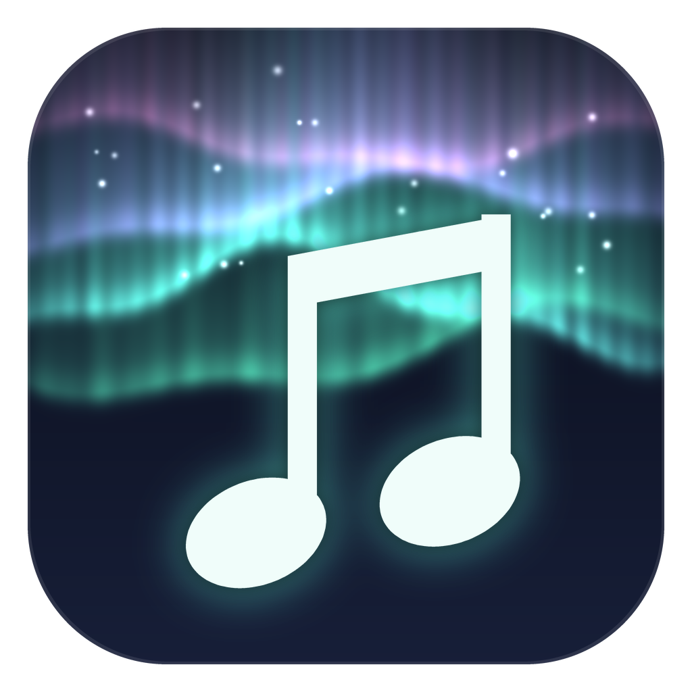

# Aurora NG



Aurora NG is [Aurora](https://github.com/soundtrackgeek/aurora) rebuilt as a native Rust app with [GPUI](https://gpui.rs), the GPU-accelerated UI framework behind the Zed editor.

Version **0.14.0** browses and searches your library, shows a wall of album covers, plays music, rates and loves tracks (also with Windows-wide shortcuts), counts your plays together with Aurora and Music Library, and keeps itself up to date.

## What it does

- **Browse**: three columns, **Artists → Albums → Tracks**. Click an artist to see their albums (oldest first), and click an album to see its tracks. Long lists scroll smoothly, even with tens of thousands of artists.
- **Cover wall**: click **Cover wall** in the header to swap the columns for a grid of every album's cover, in artist order. From 300 pixels up, every cover also shows two more lines under its title: genre · label · track count · length, then the average rating in stars and the Album Score. Click a cover to open the album's details right below its row, pushing the covers underneath down: a header with the same info (only on smaller covers, where it isn't already under the cover), then every track with its number, title, artist (when it differs from the album artist), time, star rating and a heart for loved tracks. Click the cover again or press Esc to close the details. Double-click a cover to play the album, or double-click a track in the details to play from there. Typing an artist's name jumps to their albums. Drag the **Size** slider in the header to make the covers anywhere from 50 to 500 pixels wide; the wall updates as you drag. Below 100 pixels, the titles are hidden so more covers fit. Click **Cover wall** again to go back to the columns, with the same album selected.
- **Picks up where you left off**: closing the app remembers the view (cover wall or columns), the cover size, the search, the selected album and track, whether its details were open, and the window's position and size. The next start opens the same way, with that album in view. The first start opens on the cover wall with 500-pixel covers. The settings are kept in `%LOCALAPPDATA%\aurora_ng\settings.json`; delete it to start fresh.
- **Search**: the box in the header filters the albums, on the cover wall and in the columns, with the same search language as Aurora ([Aurora's search guide](https://github.com/soundtrackgeek/aurora/blob/master/docs/search.md)). Click it or press **Ctrl+K** (or **Ctrl+F**) and type; the search starts once you stop typing for 2 seconds, or right away with **Enter**. **Esc** or **Clear** empties the box and shows everything again; a second **Esc** leaves the box. The header then shows how many albums matched, like "1,756 of 73,931 albums · 412 artists". The selected album stays selected (with its details open) when it is among the results, and the search is remembered for the next start. Some examples:

  | Query | Finds |
  | --- | --- |
  | `aartist:"bon jovi"` | Albums whose album artist is exactly Bon Jovi |
  | `aartist:bon jovi` | Album artists with words starting with "bon" and "jovi": Bon Jovi and Jon Bon Jovi |
  | `year:2000..2009 AND genre:scores AND cr:..99` | Score albums from 2000 through 2009 that are 0–99% rated |
  | `year:1980..1985 AND cr:..99 AND love:1.. NOT genre:scores OR soundtrack` | 1980–1985 albums, not fully rated, with at least one loved track, that are neither scores nor soundtracks |

  Fields: `artist:` (track artist), `aartist:` (album artist), `album:`, `title:`, `genre:`, `publisher:`, `country:`, `year:` (original year), `ryear:` (release year), `cr:` (rating completeness %), `love:` (loved tracks), `single:` (official singles), `minutes:`, `ar:` (album rating, 0–5), `bb:`, `uk:`, `vg:` (chart ranks), `born:`, `dead:`, `founded:`, `dissolved:`. Unquoted words match word beginnings; quotes match the whole value exactly. Combine with `AND` or a comma, `OR` (the value after it keeps the field: `year:1985 OR 1987`) and `NOT` or a leading `-`; operators must be uppercase. Ranges use `..` and include both ends: `year:1985..`, `cr:50..80`, `love:..3`. `genre:scores` stands for the film, TV and game score genres (Action, Animation, Comedy, Documentary, Drama, Fantasy, Horror, Sci-Fi, Thriller, TV, Video Game, Western, Anime). `sonic:` is not available, since it needs Aurora's audio analysis. A query that is not valid shows what is wrong next to the box.

  **Sorting the cover wall** (Aurora NG only; Aurora has no `sort:`): add one `sort:` anywhere in the query, on its own or with a search, separated by a space, comma or `AND`, like `genre:scores sort:random` or `year:1980..1989, sort:..year`. It changes the order of the cover wall; the columns keep their artist order.

  | Sort | Order |
  | --- | --- |
  | `sort:random` | Shuffled. Press **Enter** in the search box or click **Shuffle** for a new draw |
  | `sort:year..` / `sort:..year` | Oldest first / newest first; albums without a year go last |
  | `sort:album az` / `sort:album za` | Album title A–Z / Z–A (`sort:albums` works too) |
  | `sort:aartist az` / `sort:aartist za` | Album artist A–Z / Z–A |
  | `sort:az` / `sort:za` | Short for `sort:album az` / `sort:album za` |

  Without `az` or `za`, `sort:album` and `sort:aartist` sort A–Z. Albums in the same year are ordered by artist, then title; albums with the same title by artist, then year. The shuffled order is remembered, so the app opens with the same draw after a restart.
- **Rate tracks**: click a star next to a track to give it one to five stars: in the album's details on the cover wall, in the **Tracks** column, or next to the playing track in the now-playing bar. Hovering shows the rating a click will give. Clicking the stars a track already has clears its rating. The playing track can also be rated from anywhere with the shortcuts below. Ratings are always whole stars; half stars set in other programs are still shown. Rating works the way it does in Aurora:
  1. The rating is written into the MP3 itself, as the `POPM` frame MusicBee and Aurora use (owner `MusicBee`; 1★ = 1, 2★ = 64, 3★ = 128, 4★ = 196, 5★ = 255). An old Windows-style `Default` rating frame is replaced; other players' rating frames and every other tag are kept. The new tag goes into a hidden working copy next to the MP3, which is checked (the rating reads back, every other tag and the audio itself are unchanged) and then swapped in with one atomic replace, so the MP3 is never left half written.
  2. Music Library is then asked to read that one file again, through the same bridge Aurora uses (`music-library.exe --aurora-bridge`). It updates its catalog: the track's rating, and the album's rating and Album Score, which the app then shows. Aurora NG still never writes the catalog itself.

  The new rating shows right away. When Music Library can't be reached or is busy, the rating stays in the MP3 and in `%LOCALAPPDATA%\aurora_ng\pending-ratings.json`, keeps showing, and is handed to Music Library again every 30 seconds, also after a restart; the now-playing bar says how many are waiting. Only MP3s can be rated. Music Library must be installed in `%LOCALAPPDATA%\Music Library` (or set `AURORA_MUSIC_LIBRARY_EXE` to its `music-library.exe`, as for Aurora).
- **Shortcuts that work everywhere**: the same keys as Aurora, working even while another program has focus. Rating and Love always go to the track that is **playing**, never to the one selected in the window.

  | Keys | Does |
  | --- | --- |
  | **Ctrl+Alt+P** | Play or pause |
  | **Ctrl+Alt+N** | Next track |
  | **Ctrl+Alt+Num 1** … **Num 5** | Rate the playing track 1 to 5 stars |
  | **Ctrl+Alt+Num 0** | Clear its rating |
  | **Ctrl+Alt+L** | Toggle Love: loved becomes neutral, anything else becomes loved |

  The rating keys are on the numeric keypad, with Num Lock on. Love is saved like a rating, into the MP3 first (MusicBee's `LOVE RATING` tag, `L`) and then into Music Library; the now-playing bar shows a heart for the playing track. Windows lets only one program own a shortcut, so **don't run Aurora and Aurora NG at the same time**: whichever starts second can't use the keys, and Aurora NG then names the ones it couldn't get in the now-playing bar. Close the other program and restart Aurora NG to get them back.
- **Find an artist**: start typing a name anywhere in the window ("pink f") to jump to the first matching artist (not while typing in the search box).
- **Play**: double-click an album to play it from the start, or double-click a track to play the album from that track. The album plays through to the end.
- **Now playing bar**: previous, play/pause and next buttons, plus elapsed and total time. Click the progress bar to jump to that point in the track. **Previous** restarts the track, or goes back one track during its first 3 seconds. On the right, **Your registered plays** and **Your listening time** show how often you have played the track and for how long, as in Aurora.
- **Listening history, shared with Aurora and Music Library**: a play registers once you have listened to 30 seconds of a track (or all of it, when it is shorter), the same rule as Aurora. Only listening counts: pausing stops the clock, and seeking ahead adds nothing. The plays and listening time shown add up every history:
  - Aurora NG's own, in `%LOCALAPPDATA%\aurora_ng\aurora-history.sqlite3`. It uses Aurora's history format, under its own device name (`aurora-ng-<computer>`), and is never mixed into Aurora's file.
  - Aurora's on this computer (`%APPDATA%\com.soundtrackgeek.aurora\aurora-history.sqlite3`) and Music Library's player (Tonehavn), read live but never written.
  - Every other computer's history in `%USERPROFILE%\OneDrive\_musicbackup` (`aurora-history-*.sqlite3`, and `tonehavn-history`).

  Aurora NG publishes its own history there as `aurora-history-aurora-ng-<computer>.sqlite3`, at most once a minute while playing and when it closes, so Aurora counts Aurora NG's plays in its inspector, reports and history too. If the local file is lost, the next start restores it from that copy. Registered plays also go to Music Library's listening history through its bridge (`recordPlays`, every 2 minutes, retried later when Music Library can't be reached); Music Library ignores plays it already has from Aurora, so nothing is counted twice. Which plays have been sent is kept in `%LOCALAPPDATA%\aurora_ng\library-plays.json`. Aurora's played-threshold setting is per device; Aurora NG always uses 30 seconds.
- **Space** plays or pauses.
- **Updates**: the app checks for a new release when it starts and every 30 minutes after that. Click **Check for updates** in the header to check right away. When a new version is out, click **Update to vX.Y.Z** to download it, replace the app and restart.

## Download

Get `aurora_ng-windows-x64.exe` from the [latest release](https://github.com/soundtrackgeek/aurora_ng/releases/latest) and run it. The download is its own installer: the first time it runs, it

- copies itself to `%LOCALAPPDATA%\Programs\Aurora NG\Aurora NG.exe` (no admin rights needed),
- adds **Aurora NG** to the Start Menu,
- starts the installed copy and closes.

Open it from the Start Menu from then on; right-click it there to **Pin to Start** or **Pin to taskbar**. The downloaded file can be deleted. Running the download again installs it over the old copy (close the app first). The app updates itself in place, so the Start Menu entry and pins keep working after updates.

To uninstall, delete the `%LOCALAPPDATA%\Programs\Aurora NG` folder and the Start Menu shortcut (`%APPDATA%\Microsoft\Windows\Start Menu\Programs\Aurora NG.lnk`).

## Your library

Aurora NG reads the same catalog as Aurora: Music Library's database at

```
%APPDATA%\com.local.musiclibrary\music-library.sqlite3
```

It opens the catalog read-only and never changes it; when you rate a track, Music Library updates the catalog (see **Rate tracks**). Music Library must have imported your music first. To use a catalog somewhere else, set the `AURORA_NG_CATALOG` environment variable to its full path before starting the app.

## Album covers

The cover wall uses one image per album, named after the album's folder: the album in `D:\MUSIC\Kittie - Oracle (2001)` uses `Kittie - Oracle (2001).jpg` (JPG, PNG, GIF or BMP; case does not matter). Covers are read from

```
C:\_code\music_backup_v5\AlbumCovers
```

To use another folder, set the `AURORA_NG_COVERS` environment variable to it. Albums without a cover show their title instead. The header shows how many albums have a cover.

The original images are never changed. Square copies are made as you scroll, in four sizes (128, 256, 512 and 1024 pixels) so covers stay sharp at every size on the slider. They are saved in `%LOCALAPPDATA%\aurora_ng\thumbnails`, so covers load instantly the next time. That folder can be deleted at any time; the copies are made again when needed.

Audio files are played from the folders the catalog records (for example `D:\MUSIC\...`). MP3, FLAC, M4A/AAC, Ogg Vorbis and WAV are supported.

## Building and running

You need Rust **1.95.0** (pinned in `rust-toolchain.toml`; rustup installs it automatically) and, on Windows, the MSVC build tools.

```powershell
cargo run --release
```

The first build compiles GPUI and takes several minutes. Run the tests with `cargo test`.

## App icon

The icon (aurora curtains over a night sky, with a pair of music notes) is built into the exe, so Explorer, the Start Menu, the taskbar and the window all show it, as does the Start Menu shortcut the app makes when it installs itself. `build.rs` embeds `assets/app-icon/aurora_ng.ico` together with the app's name and version, which Windows shows in the file's Properties and in Task Manager.

The icon is drawn by a script. To change it, edit `assets/app-icon/generate.py` and run it from the repository root (needs Python with Pillow and numpy):

```powershell
python assets/app-icon/generate.py
```

It writes the `.ico` (10 sizes, 16 to 256 pixels; the smallest ones are simplified so they stay sharp), a 1024-pixel `aurora_ng.png`, and `preview.png` with every size side by side for checking by eye.

## Releasing

Every push to `master` is built and tested by GitHub Actions (`.github/workflows/ci.yml`), which also keeps the build cache warm. Releases are built by `.github/workflows/release.yml`:

1. Bump `version` in `Cargo.toml` and add the matching section to `CHANGELOG.md`.
2. Commit, then tag and push: `git tag v0.4.0 && git push origin v0.4.0`. Wait for the CI run on `master` to finish first, so the release can reuse its cache.

The workflow checks that the tag matches `Cargo.toml`, runs the tests, builds the release exe and publishes it with that version's changelog notes. Running apps pick it up within 30 minutes.
